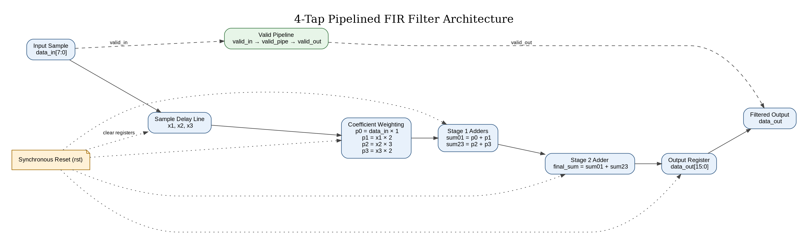
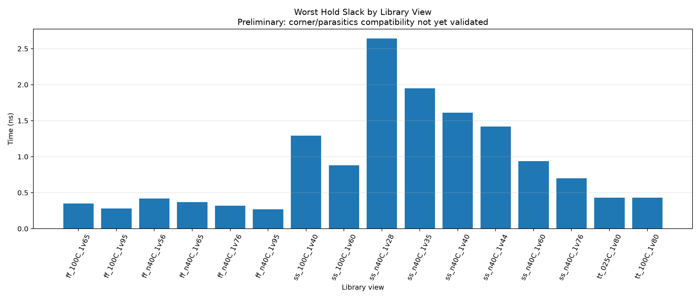
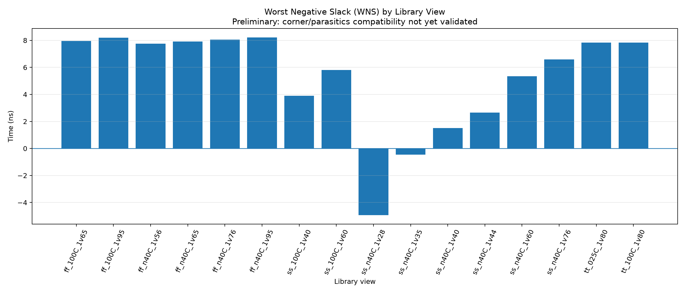
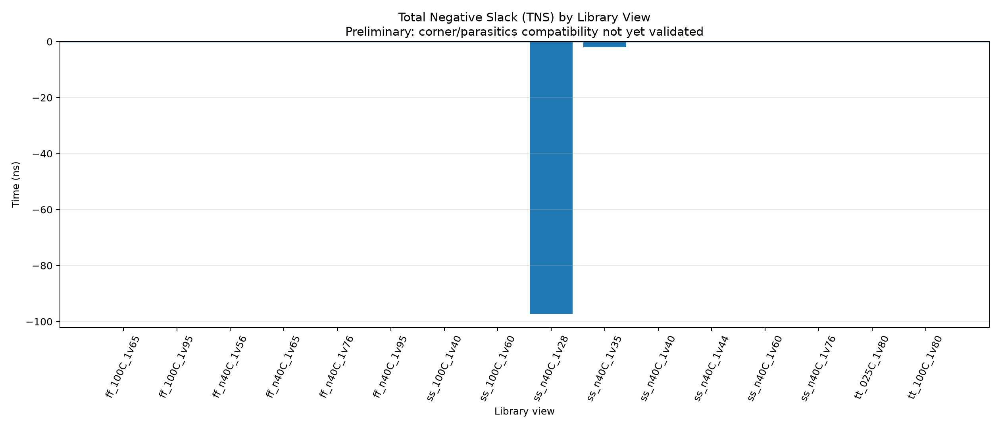

# 4-Tap Pipelined FIR Filter — RTL to GDS

<p align="center">
  <strong>Verilog RTL • Functional Verification • Synthesis • Physical Design • Static Timing Analysis</strong>
</p>

A hardware-design project implementing a **4-tap pipelined Finite Impulse Response (FIR) filter** in synthesizable Verilog. The repository documents the RTL, simulation and synthesis checks, physical-design evidence, and exploratory timing analysis using the SkyWater SKY130HD standard-cell flow.

> **Project status note:** Simulation and generic synthesis checks are documented below. The available 16-view timing exploration is not a corner-specific signoff run; full multi-corner signoff remains unverified. Results are reported as measured and should not be interpreted as tapeout signoff.

## Table of Contents

- [Project Overview](#project-overview)
- [Highlights](#highlights)
- [FIR Architecture](#fir-architecture)
- [Repository Structure](#repository-structure)
- [Tools and Libraries](#tools-and-libraries)
- [Run the Docker Checks](#run-the-docker-checks)
- [Verification Results](#verification-results)
- [Synthesis Results](#synthesis-results)
- [Physical Design Evidence](#physical-design-evidence)
- [Static Timing Analysis](#static-timing-analysis)
- [Project Video Demo](#project-video-demo)
- [How to Explore the Project](#how-to-explore-the-project)
- [Limitations and Next Steps](#limitations-and-next-steps)

## Project Overview

An FIR filter computes an output from the current input sample and a finite number of previous samples, weighted by coefficients. This implementation uses a four-tap structure and pipeline registers to organize the datapath.

**Project goals**
- Implement a synthesizable, sequential FIR datapath in Verilog RTL.
- Verify the design using a testbench and waveform inspection.
- Run synthesis and inspect the generated netlist/statistics.
- Collect physical-design evidence such as floorplanning, placement, clock-tree synthesis (CTS), and routing.
- Explore setup and hold timing across available library views.
- Keep the workflow reproducible through Docker-based checks.

## Highlights

- **RTL and testbench:** Verilog source and simulation checks.
- **Simulation:** Icarus Verilog; waveform inspection with GTKWave.
- **Synthesis:** Yosys generic synthesis and netlist validation.
- **Containerized checks:** Docker environment for repeatable simulation and synthesis checks.
- **Physical design:** Evidence screenshots for floorplan, placement, CTS, routing, and final layout.
- **Timing exploration:** setup/hold slack and TNS comparisons for 16 available library views.

## FIR Architecture

The four-tap FIR datapath uses the input sample and delayed samples, coefficient weighting, adders, and registered output/control signals.



Editable diagram source, if present in the repository: [`fir_block_diagram.dot`](fir_block_diagram.dot).

Additional architecture evidence: [Image Evidences/01_architecture](Image%20Evidences/01_architecture/).

## Repository Structure

```text
.
├── rtl/                       # Synthesizable Verilog RTL
├── tb/                        # Testbench sources
├── sim/                       # Simulation-related files/artifacts
├── synth/                     # Synthesis scripts, netlists and reports
├── sta/                       # Timing constraints
├── STA_16_CORNERS/             # Exploratory timing summaries and graphs
├── FINAL_EVIDENCE/             # Selected project evidence
├── Image Evidences/             # Categorized screenshots and image evidence
│   ├── 01_architecture/
│   ├── 02_simulation/
│   ├── 03_docker/
│   ├── 04_synthesis/
│   ├── 05_physical_design/
│   ├── 06_sta/
│   ├── 07_general_evidence/
│   └── README.md
├── Dockerfile                  # Container environment definition (if present)
└── compose.yaml                # Docker Compose configuration (if present)
```

Folder names may vary slightly depending on the files present in the checked-out branch.

## Tools and Libraries

| Tool / Library | Purpose |
|---|---|
| Verilog HDL | RTL implementation and testbench design |
| Icarus Verilog | RTL simulation |
| GTKWave | Viewing and inspecting simulation waveforms |
| Yosys | RTL synthesis and synthesis statistics |
| Docker | Reproducible tool environment |
| Docker Compose | Running the configured container workflow |
| SkyWater SKY130HD standard-cell library | Standard-cell technology library used in the physical-design flow |
| OpenROAD / OpenROAD-flow-scripts | Physical-design flow tooling, where configured |
| OpenSTA | Static timing analysis tooling, where configured |

Tool availability depends on the environment used for each run. Docker-based generic synthesis results are distinct from technology-mapped SKY130 results and from physical-design signoff.

## Run the Docker Checks

Run these commands from the repository root, if Docker and Docker Compose are installed:

```bash
docker compose build
docker compose run --rm <service-name>
```

Replace `<service-name>` with the service defined in `compose.yaml`. Check the compose file for the exact service name and any provided test/synthesis commands.

Previously recorded Docker evidence reported:
- Icarus Verilog version 12.0
- Yosys version 0.33
- All 8 recorded FIR output vectors passed
- Generic Yosys synthesis completed
- Netlist validation reported zero problems

See [Image Evidences/03_docker](Image%20Evidences/03_docker/) for screenshots. The exact commands/results should be checked against the committed Docker configuration and evidence files.

## Verification Results

The recorded simulation checked eight output vectors and reported:

**PASS: All 8 FIR outputs verified.**

The recorded sample values were:

`10, 40, 100, 180, 260, 340, 420, 500`

Use the testbench and simulation output in the repository as the primary source for verification details. Waveform screenshots are available under [Image Evidences/02_simulation](Image%20Evidences/02_simulation/).

## Synthesis Results

A generic Yosys synthesis run reported **23 generic cells**:
- 3 `$add`
- 4 `$dff`
- 1 `$mul`
- 4 `$mux`
- 11 `$sdff`

Netlist validation reported zero problems. These are generic synthesis statistics from the Docker environment, not a claim about the final number of SKY130 standard cells. See [Image Evidences/04_synthesis](Image%20Evidences/04_synthesis/).

## Physical Design Evidence

Screenshots are organized by implementation stage:

- [Floorplan, placement, CTS, routing and final layout](Image%20Evidences/05_physical_design/)
- [Additional GUI evidence](Image%20Evidences/07_general_evidence/)

These images document the available workflow evidence. A screenshot by itself is not proof of a clean signoff; consult the actual run logs and reports for definitive status.

## Static Timing Analysis

The nominal TT run under the original SDC reported:
- Setup slack (WNS): **+7.84 ns**
- Hold slack: **+0.43 ns**
- TNS: **0.00 ns**

Two exploratory SS library-view runs reported negative setup slack:
- SS, −40 °C, 1.28 V: WNS **−4.94 ns**, TNS **−97.22 ns**
- SS, −40 °C, 1.35 V: WNS **−0.46 ns**, TNS **−2.00 ns**

The 16-view analysis reused the same SPEF file across views. Therefore, it is an **exploratory comparison, not corner-specific multi-corner signoff**. Full multi-corner signoff remains unverified.

### Timing comparison graphs

#### Setup slack


#### Hold slack


#### WNS


#### TNS


Detailed results: [STA summary CSV](STA_16_CORNERS/STA_16_Corners_Summary.csv) · [STA Excel report](STA_16_CORNERS/STA_16_Corners_Report.xlsx).

More evidence: [Image Evidences/06_sta](Image%20Evidences/06_sta/).

## Project Video Demo

**Video link:** *Will be added here.*

When the demo is uploaded, replace the placeholder with a shareable link, for example:

```markdown
[Watch the FIR Filter Project Demo](PASTE_VIDEO_URL_HERE)
```

## How to Explore the Project

1. Read the RTL files in `rtl/`.
2. Review the testbench in `tb/`.
3. Run the configured simulation and inspect waveforms in GTKWave.
4. Review synthesis scripts, generated netlist and statistics.
5. Browse the physical-design evidence by stage.
6. Review the STA CSV, graphs and report notes, paying attention to the signoff limitation.

## Limitations and Next Steps

- Re-run timing analysis with the correct library and parasitic data for each corner before claiming multi-corner signoff.
- Confirm setup and hold constraints, clock definitions, I/O delays, input transitions, and output loads against the intended interface.
- Review detailed DRC, LVS, and timing reports before making any signoff claim.
- Add the final demonstration video link when available.
- Keep screenshots, logs, scripts, and reported metrics aligned with the same design revision.

## Acknowledgements

This project uses open-source RTL and digital-design tooling. Refer to the individual tool and library projects for their respective licenses and documentation.
